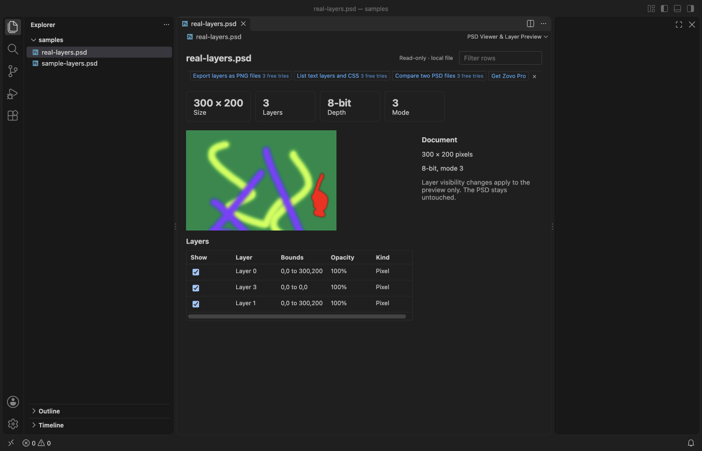

# PSD Viewer & Layer Preview

psd viewer in VS Code for a merged image preview, document details and a searchable layer list. Open PSD or PSB files offline.

- Free merged image preview with zoom through VS Code and a transparency background.
- Toggle stored pixel layers in the preview and inspect bounds, names and opacity.
- The source file stays untouched.

## Zovo Pro

Zovo Pro: USD 19 once.

- Export each stored pixel layer as a separate PNG file.
- Export text layer positions and CSS as CSV.
- Compare document dimensions and layer names in two files.

## Limits

The viewer relies on the PSD merged image when one is present. It uses a basic CMYK channel conversion and doesn't apply embedded color profiles. Layer toggles use stored pixels and normal blend mode only. Vector masks, other blend modes and edits saved back into PSD aren't supported.

Made by Zovo.

## Support Zovo

Zovo Pro: USD 19 once, every Zovo viewer. [Get Zovo Pro on GitHub Sponsors](https://github.com/sponsors/theluckystrike/sponsorships?tier_id=679878) to turn on the Pro tools in this extension and in the other Zovo extensions you use. The free features stay free.

Zovo extensions have no ads and no tracking. They are made by [theluckystrike](https://github.com/theluckystrike) on GitHub. You can also support the work with no Pro:

- [Sponsor on GitHub](https://github.com/sponsors/theluckystrike)
- [PayPal](https://www.paypal.com/paypalme/najzzz)
- [Follow theluckystrike on GitHub](https://github.com/theluckystrike)

### Need your format supported?

Open a [format request](https://github.com/theluckystrike/zovo-plugin-factory/issues/new?template=format-request.yml) with a sample file, and I reply there whether it can be done. For USD 299 once, through [this GitHub Sponsors tier](https://github.com/sponsors/theluckystrike/sponsorships?tier_id=679995), I add your file format or a missing feature to this extension, with tests, within 7 days.

## More tools by Zovo

- [PDF Viewer & PDF Reader to Read and View PDF (Dark Mode)](https://marketplace.visualstudio.com/items?itemName=zovo.pdf-viewer-dark) reads PDFs with a real dark mode, search, an outline and thumbnails.
- [XLSX Viewer, Excel Viewer, CSV Viewer & Parquet Viewer (XLS, CSV Preview)](https://marketplace.visualstudio.com/items?itemName=zovo.table-viewer-vscode) opens CSV, TSV, Excel and Parquet files as a sortable, filterable table.
- [DOCX Viewer & ODT Viewer, Word Document Preview (Dark Mode)](https://marketplace.visualstudio.com/items?itemName=zovo.docx-viewer-vscode) previews Word and ODT files with dark mode, an outline and search.

See [all Zovo extensions on the Marketplace](https://marketplace.visualstudio.com/publishers/zovo).
